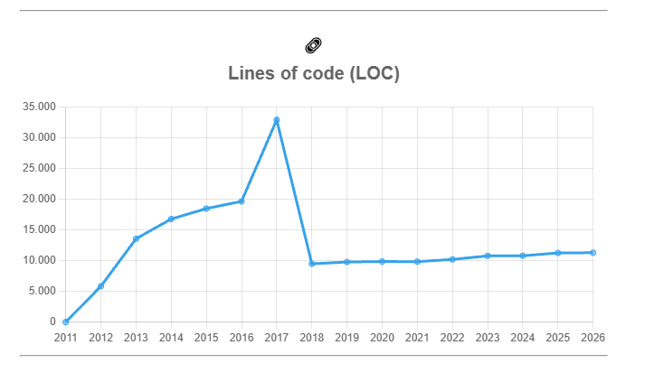

# Explorando evolução de código

Neste exercício, iremos explorar a evolução de código em sistemas reais.

Iremos utilizar a ferramenta [GitEvo](https://github.com/andrehora/gitevo).
Essa ferramenta analisa a evolução de código em repositórios Git nas linguagens Python, JavaScript, TypeScript e Java, e gera relatórios `HTML` como [este](https://andrehora.github.io/gitevo-examples/python/pandas.html).

Mais exemplos de relatórios podem ser podem ser encontrados em https://github.com/andrehora/gitevo-examples.

# Passo 1: Selecionar repositório a ser analisado

Selecione um repositório relevante na linguagem de sua preferência (Python, JavaScript, TypeScript ou Java).
Você pode encontrar projetos interessantes nos links abaixo:

- Python: https://github.com/topics/python?l=python
- JavaScript: https://github.com/topics/javascript?l=javascript
- TypeScript: https://github.com/topics/typescript?l=typescript
- Java: https://github.com/topics/java?l=java

# Passo 2: Instalar e rodar a ferramenta GitEvo

> [!NOTE]
> Antes de instalar a ferramenta, é recomendado criar e ativar um [ambiente virtual Python](https://packaging.python.org/en/latest/guides/installing-using-pip-and-virtual-environments/#create-and-use-virtual-environments).

Instale a ferramenta [GitEvo](https://github.com/andrehora/gitevo) com o comando:

```
$ pip install gitevo
```

Execute a ferramenta no repositório selecionado utilizando o comando abaixo (ajuste conforme a linguagem do repositório).
Substitua `<git_url>` pela URL do repositório que será analisado:

```shell
# Python
$ gitevo -r python <git_url>

# JavaScript
$ gitevo -r javascript <git_url>

# TypeScript
$ gitevo -r typescript <git_url>

# Java
$ gitevo -r java <git_url>
```

Por exemplo, para analisar o projeto Flask escrito em Python:

```
$ gitevo -r python https://github.com/pallets/flask
```

> [!NOTE]
> Essa etapa pode demorar alguns minutos pois o projeto será clonado e analisado localmente.

# Passo 3: Explorar o relatório de evolução de código

Após executar a ferramenta [GitEvo](https://github.com/andrehora/gitevo), é gerado um relatório `HTML` contendo diversos gráficos sobre a evolução do código.

Abra o relatório `HTML` e observe com atenção os gráficos.

# Passo 4: Explicar um gráfico de evolução de código

Selecione um dos gráficos de evolução e explique-o com suas palavras.
Por exemplo, você pode:

- Detalhar a evolução ao longo do tempo
- Detalhar se as curvas estão de acordo com boas práticas
- Explicar grandes alterações nas curvas
- Explorar a documentação do repositório em busca de explicações para grandes alterações
- etc.

Seja criativo!

# Instruções para o exercício

1. Crie um `fork` deste repositório (mais informações sobre forks [aqui](https://docs.github.com/pt/pull-requests/collaborating-with-pull-requests/working-with-forks/fork-a-repo)).
2. Adicione o relatório `HTML` no seu fork.
3. No Moodle, submeta apenas a URL do seu `fork`.

Responda às questões abaixo diretamente neste arquivo `README.md` do seu fork:

1. Repositório selecionado: https://github.com/psf/requests
2. Gráfico selecionado: 
3. Explicação:

O gráfico mostra a evolução do número de linhas de código (LOC) do projeto Requests entre 2011 e 2026, com um snapshot por ano.

**Crescimento (2011–2016).** O valor de 2011 é 0 porque o snapshot desse ano corresponde ao primeiro commit do projeto, que ainda não continha arquivos `.py`. A partir de 2012 (~5,8 mil linhas), o código cresce continuamente até ~19,6 mil linhas em 2016. Esse crescimento, porém, não era apenas código do próprio Requests: o projeto mantinha cópias de outras bibliotecas dentro de `requests/packages/`, prática conhecida como *vendoring*.

**Pico e queda (2017–2018).** O snapshot de 2017 atinge ~32,8 mil linhas, mas cerca de 24,2 mil delas pertenciam às bibliotecas embutidas (`urllib3`, `chardet` e `idna`); o código próprio era de apenas ~8,6 mil linhas. Na versão 2.16.0 (26/05/2017), registrada no `HISTORY.md` como "Unvendor ALL the things!", essas cópias foram removidas e as bibliotecas passaram a ser dependências instaladas via pip. Por isso o LOC cai para ~9,4 mil em 2018. Nenhuma funcionalidade foi removida; apenas saiu do repositório o código que não era do projeto. A queda aparece em 2018, e não em 2017, porque o GitEvo analisa um commit do início de cada ano.

**Estabilidade (2018–2026).** Após a remoção, o código cresce lentamente, de ~9,4 mil para ~11,3 mil linhas em oito anos, comportamento típico de um projeto maduro em fase de manutenção.

**Conclusão.** O gráfico mostra que LOC, isoladamente, pode enganar: o pico de 2017 não indicava um Requests maior, e sim código de terceiros dentro dele. A remoção do *vendoring* foi uma boa prática, pois reduziu o tamanho do repositório e passou a responsabilidade de manter cada dependência ao seu próprio projeto. Correções de segurança no `urllib3`, por exemplo, chegam pelo pip sem que alguém precise copiar o código novamente para dentro do Requests.